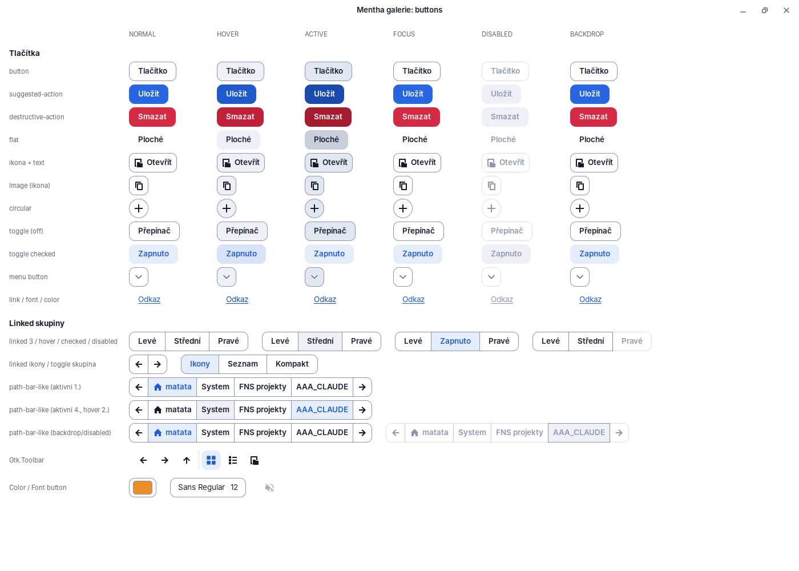
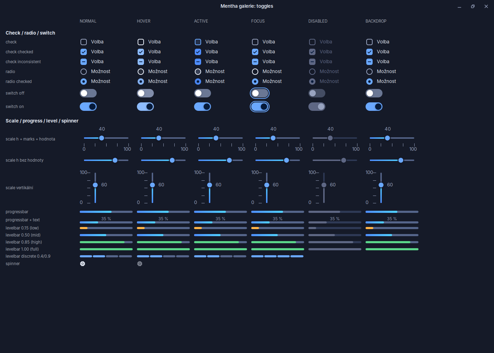
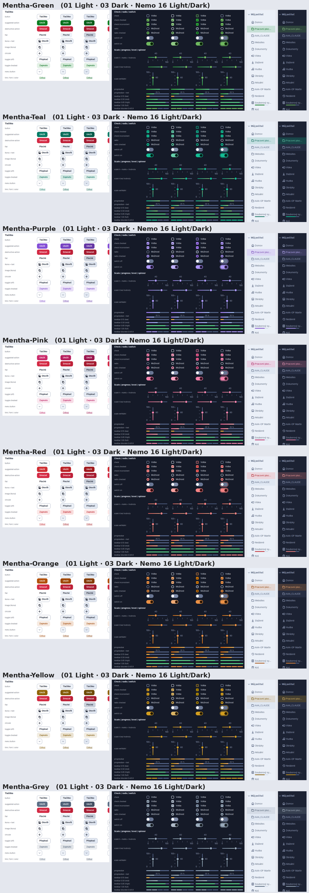

# Mentha

[](https://ko-fi.com/matata86)

A modern, calm blue theme for **Linux Mint Cinnamon** (6.x, GTK 3.24, libadwaita). Light and Dark variants,
rounded geometry, flat buttons and switches, gradients only on level and progress bars. Built for
Mint 22.x; the accent colour is a single token, so every colour variant is generated from one source.




## What is in it

- **GTK 3 / GTK 2** (based on Orchis), **GTK 4 / libadwaita 1.5 and 1.7** (recoloured Mint-Y), **Cinnamon shell** (Mint-Y layer).
- **Accent colours:** blue (default), green, teal, purple, pink, red, orange, yellow, grey. Text and selection
  contrast is checked at build time (`build/gtk-validate.py`, WCAG).
- Dock, calendar, notifications, OSD and Nemo sidebar details tuned for Cinnamon 6.6.



## Build and install

Requires `bash`, `python3`, `rsync` and `sassc` (or `npx`, then `build/bin/sassc` runs dart-sass).

```bash
./build.sh                       # dist/Mentha-Light and dist/Mentha-Dark (blue)
MENTHA_ACCENT=green ./build.sh   # another accent (keys in src/tokens.json -> accents)
python3 build/gtk-validate.py    # contrast checks for all accents
./install.sh                     # copy to ~/.themes and reload
```

Colour variants installed side by side: `MENTHA_NORELOAD=1 MENTHA_THEME=Mentha-Green ./install.sh`.

Everything visual comes from `src/tokens.json`; the SCSS in `src/` only references tokens. `src/tokens.json`
accents other than blue are produced by `build/gen-accents.py`.

## Notes

- The notification bubble layout (image under the icon, smaller image) needs a small applet override
  because Cinnamon hard-codes the sizes in JS. It is not part of the theme.
- `tools/` holds the screenshot harness (isolated Broadway display, never touches your session).

## Credits and licence

Mentha is a derivative of [Orchis](https://github.com/vinceliuice/Orchis-theme) (Vince Liuice) and
[mint-themes / Mint-Y](https://github.com/linuxmint/mint-themes) (Clement Lefebvre and the Linux Mint team),
the accent hues follow [Tela-circle](https://github.com/vinceliuice/Tela-circle-icon-theme). The needed
upstream files are kept unmodified in `upstream/` (see `upstream/PINS.md`).

Licensed under **GPL-3.0**, see [LICENSE](LICENSE).

If you like it, you can [buy me a coffee on Ko-fi](https://ko-fi.com/matata86).
